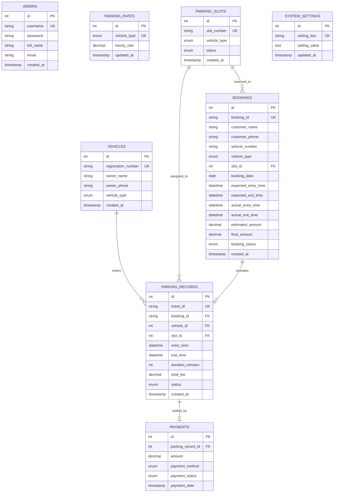

# CU SmartPark – Vehicle Parking Management System
### Chandigarh University (CU) – College DBMS Project

[](https://www.cuchd.in/)
[](https://www.php.net/)
[](https://www.mysql.com/)
[]()
[]()

A modern, full-stack, enterprise-grade **Vehicle Parking Management and Online Reservation System (CU SmartPark)** developed for **Chandigarh University, Gharuan, Mohali**. SmartPark automates campus parking allocations for faculty, students, and visitors, duration-based tariff billing, advance online bay reservations, exit settlements, real-time occupancy grids, and analytical reporting.

---

## 1. Project Introduction

Urban transit centers, shopping malls, and commercial complexes face major bottlenecks in parking allocation, physical ticket tracking, fee calculation errors, and revenue leakage. **SmartPark** solves these challenges by providing a centralized, database-backed platform that tracks the complete lifecycle of parked vehicles—from initial check-in and dynamic bay assignment to automatic duration calculation and verified fee settlement.

---

## 2. Project Objectives

1. **Automate Bay Allocation:** Provide real-time occupancy mapping across distinct vehicle categories (Two Wheeler, Car, SUV, Other).
2. **Eliminate Billing Errors:** Enforce standardized billing rules (1-hour minimum charge, ceiling round-up for partial hours) via programmatic database queries.
3. **Ensure Relational Integrity:** Enforce foreign key constraints, unique constraints, and atomic transactions to prevent duplicate parking entries and orphan billing records.
4. **Streamline Auditing & Revenue Tracking:** Provide exportable transaction audits, payment logs, and visual revenue trends.
5. **Educational & Practical Value:** Serve as an exemplary DBMS reference project illustrating normalization, transaction management, indexing, and prepared PDO statements.

---

## 3. Software Requirements

### Development & Server Environment
* **Web Server:** Apache 2.4+ (or PHP built-in CLI server)
* **PHP:** PHP 8.0 or higher (PHP 8.2 / 8.3 recommended)
* **PHP Extensions:** `pdo`, `pdo_mysql`, `mbstring`, `session`, `openssl` (optional: `pdo_sqlite` for standalone offline mode)
* **Database Server:** MySQL 8.0+ or MariaDB 10.4+
* **Web Browser:** Google Chrome, Mozilla Firefox, Microsoft Edge, or Safari

---

## 4. Technologies Used

| Tier | Technologies |
| :--- | :--- |
| **Frontend** | HTML5 Semantic Markup, CSS3 Modern SaaS Styling, Vanilla JavaScript (ES6+), Font Awesome 6, Google Fonts (Inter) |
| **Visualization** | Chart.js 4.4+ (Daily Revenue Line Chart, Daily Entries Bar Chart, Category Doughnut Chart, Monthly Volume) |
| **Backend** | Pure PHP 8.3+ (No bloated frameworks; clean, beginner-friendly modular architecture) |
| **Database** | MySQL / MariaDB (InnoDB storage engine, relational foreign keys, B-Tree indexes) |
| **Connectivity** | PHP Data Objects (PDO) with prepared statements to prevent SQL Injection |

---

## 5. System Features

* **Secure Authentication:** Session-based authentication, BCRYPT password hashing, and login brute-force protection.
* **Interactive Dashboard:**
  * Real-time metrics: Total Slots, Available Slots, Occupied Slots, Vehicles Today, Today's Revenue.
  * Live visual parking occupancy grid with color badges (Green = Available, Red = Occupied, Yellow = Reserved).
  * 7-day revenue trend chart.
  * Latest 10 check-in/checkout activity feeds.
* **Parking Slot Management:**
  * Full CRUD (Create, Read, Update, Delete) for parking bays.
  * Live search and multi-criteria filters by availability and vehicle category.
  * **Referential Safeguards:** Prevents deletion of occupied slots or bays referenced in historical logs.
* **Vehicle Check-In & Entry:**
  * Client-side input validation and dynamic slot filtering based on vehicle type.
  * **Duplicate Prevention:** Strict transaction check prevents parking an already active vehicle.
  * Automatic ticket generation (format: `SP-YYYYMMDD-XXXX`).
  * Print-ready digital parking receipt with barcode, bay highlight, and timestamp.
* **Vehicle Exit & Automated Billing:**
  * Instant vehicle lookup by registration number or ticket ID.
  * Automatic fee computation: 
    $$\text{Billable Hours} = \max(1, \lceil \text{Minutes} / 60 \rceil)$$
    $$\text{Total Fee} = \text{Billable Hours} \times \text{Hourly Rate}$$
  * Payment recording (Cash, UPI, Card).
  * Automatic bay release back to `Available`.
  * Printable Tax Invoice / Payment Settlement Receipt.
* **Vehicle Records & History:**
  * Searchable and paginated historical parking log.
  * Detailed modal view for each individual parking session.
  * 1-click CSV export.
* **Payment Management:**
  * Financial audit log of all completed transactions.
  * Revenue breakdown by payment method (Cash, UPI, Card).
  * CSV export for accounting reconciliation.
* **Reports & Analytics:**
  * Graphical charts: Daily entries (14 days), Vehicle type breakdown, Monthly trends.
  * Top 10 most-utilized parking slots ranked by turnover and generated revenue.
* **System Settings:**
  * Dynamic, database-driven hourly tariffs per category.
  * Parking lot branding and contact info.
  * Administrator profile and password management.

---

## 6. Database Schema & Tables

The database is named `smartpark_db` and contains 8 normalized relational tables:

```
smartpark_db
├── admins           (Administrative accounts & credentials)
├── parking_rates    (Configurable hourly tariffs per vehicle category)
├── parking_slots    (Physical bays, slot codes, and real-time status)
├── vehicles         (Registered vehicle master & owner contacts)
├── bookings         (UPGRADED: Customer advance online reservations)
├── parking_records  (Parking sessions, tickets, timestamps, fees, status)
├── payments         (Payment settlements, methods, and transaction receipts)
└── system_settings  (Facility metadata, branding, and contact details)
```

---

## 7. Entity-Relationship (ER) Diagram



---

## 8. Database Relationships & Constraints

1. **One-to-Many (`vehicles` $\rightarrow$ `parking_records`):**
   * One registered vehicle can visit the facility multiple times over its lifecycle.
   * Foreign Key: `parking_records.vehicle_id REFERENCES vehicles(id) ON DELETE RESTRICT`.
2. **One-to-Many (`parking_slots` $\rightarrow$ `parking_records`):**
   * One physical bay accommodates many historical parking sessions, but only **one** active (`status = 'Parked'`) session at any given moment.
   * Foreign Key: `parking_records.slot_id REFERENCES parking_slots(id) ON DELETE RESTRICT`.
3. **One-to-One (`parking_records` $\rightarrow$ `payments`):**
   * Each completed parking session produces exactly one financial payment record.
   * Foreign Key: `payments.parking_record_id REFERENCES parking_records(id) ON DELETE CASCADE`.

---

## 9. Installation Instructions

### Option A: Running on XAMPP (Standard College Presentation Method)

1. **Download and Install XAMPP:**
   * Download from [Apache Friends](https://www.apachefriends.org/).
   * Launch the **XAMPP Control Panel** and start **Apache** and **MySQL**.
2. **Deploy Project to htdocs:**
   * Copy the entire project folder to `C:\xampp\htdocs\smartpark`.
3. **Import Database:**
   * Open your web browser and navigate to `http://localhost/phpmyadmin`.
   * Click **New** on the left sidebar, enter database name: `smartpark_db`, and click **Create**.
   * Select `smartpark_db`, go to the **Import** tab, choose the file `database/smartpark_db.sql` located inside the project, and click **Import** (or **Go**).
4. **Access Application:**
   * Open `http://localhost/smartpark` in your browser.

---

### Option B: Built-in Quick Launch (Zero-Config / Standalone)

For quick grading or review without launching XAMPP:
1. Double-click the included `run-local-server.bat` file in the project root.
2. The server will start instantly at `http://localhost:8000`.
3. Open `http://localhost:8000` in any web browser!

---

## 10. Default Admin Credentials

Upon installation, use the following credentials to sign in:

* **Sign In URL:** `http://localhost/smartpark/login.php` (or `http://localhost:8000/login.php`)
* **Username:** `admin`
* **Password:** `admin123`
* **Role:** System Administrator

*(Password can be changed anytime via the Settings page).*

---

## 11. Example SQL Queries (College Viva Reference)

Here are the primary relational queries utilized within the SmartPark application:

### Query 1: Calculate Today's Collected Revenue
```sql
SELECT COALESCE(SUM(amount), 0) AS todays_revenue 
FROM payments 
WHERE payment_date >= CURRENT_DATE() 
  AND payment_status = 'Paid';
```

### Query 2: Active Vehicles with Bay and Owner Details (Inner Join)
```sql
SELECT r.ticket_id, v.registration_number, v.owner_name, v.vehicle_type, s.slot_number, r.entry_time
FROM parking_records r
JOIN vehicles v ON r.vehicle_id = v.id
JOIN parking_slots s ON r.slot_id = s.id
WHERE r.status = 'Parked'
ORDER BY r.entry_time ASC;
```

### Query 3: Top 5 Most Utilized Parking Bays (Aggregation & Grouping)
```sql
SELECT s.slot_number, s.vehicle_type, COUNT(r.id) AS total_sessions, COALESCE(SUM(r.total_fee), 0) AS revenue_generated
FROM parking_slots s
LEFT JOIN parking_records r ON s.id = r.slot_id
GROUP BY s.id, s.slot_number, s.vehicle_type
ORDER BY total_sessions DESC
LIMIT 5;
```

### Query 4: Vehicle Category Breakdown
```sql
SELECT vehicle_type, COUNT(*) AS total_count 
FROM vehicles 
GROUP BY vehicle_type;
```

---

## 12. College DBMS Theory & Viva Documentation

### What is a DBMS?
A **Database Management System (DBMS)** is specialized software that defines, manipulates, retrieves, and manages data stored in a computerized database. It provides data independence, transactional integrity, concurrency control, and security compared to traditional file storage systems.

### Why is MySQL Used in This Project?
1. **Relational Model (RDBMS):** Organizes data into structured tables with strict column definitions and relationships.
2. **ACID Compliance:** Through the InnoDB storage engine, MySQL guarantees Atomicity, Consistency, Isolation, and Durability across checkout and check-in transactions.
3. **High Performance & Portability:** Native integration with PHP PDO, cross-platform support (Windows/Linux/Mac), and standard SQL support.

### What is a Primary Key?
A **Primary Key (PK)** is a column (or set of columns) that uniquely identifies each tuple (row) in a table. It must contain unique values and cannot contain NULL values. 
*Example:* `id` in `parking_slots`, `ticket_id` in `parking_records`.

### What is a Foreign Key?
A **Foreign Key (FK)** is a field (or collection of fields) in one table that references the primary key of another table. It establishes a link between tables and maintains **Referential Integrity**.
*Example:* `slot_id` in `parking_records` references `id` in `parking_slots`.

### What is Database Normalization?
Normalization is a systematic database design technique that minimizes data redundancy and prevents insertion, update, and deletion anomalies.
* **1NF (First Normal Form):** Each column contains atomic (indivisible) values and each row is uniquely identifiable.
* **2NF (Second Normal Form):** Meets 1NF, and all non-key attributes are fully functionally dependent on the primary key (no partial dependencies).
* **3NF (Third Normal Form):** Meets 2NF, and no non-key attribute depends transitively on the primary key (no transitive dependencies). 
*SmartPark is fully normalized to 3NF.*

### How CRUD Operations Work in SmartPark
* **Create (INSERT):** Registering a new vehicle, creating parking tickets, recording payments.
* **Read (SELECT):** Displaying real-time slot occupancy grids, generating reports, filtering parking records.
* **Update (UPDATE):** Changing parking slot status (`Available` $\rightarrow$ `Occupied` $\rightarrow$ `Available`), recording checkout timestamps, modifying tariff rates.
* **Delete (DELETE):** Deleting vacant parking slots while blocking occupied or referenced records.

---

## 13. Future Scope

1. **Automated License Plate Recognition (ALPR):** Integrate computer vision cameras at the boom barrier for hands-free vehicle entry.
2. **IoT Ultrasonic Sensor Integration:** Connect hardware ESP32 / Arduino sensors on each bay to detect physical car occupancy automatically.
3. **Public Reservation Portal:** Allow drivers to pre-book bays online via UPI / payment gateway prior to arrival.
4. **Electric Vehicle (EV) Charging Management:** Track kWh consumed and bundle EV charger tariffs directly into the exit bill.

---

## 14. Project Structure

```
smartpark/
│
├── index.php                 # Entry router (redirects to dashboard or login)
├── login.php                 # Secure administrator login page
├── logout.php                # Session termination and logout handler
├── booking.php               # Customer-facing online parking reservation page
├── booking-confirmation.php  # Public booking confirmation slip & printable ticket
├── booking-lookup.php        # Customer reservation status & self-service cancellation
├── run-local-server.bat      # Quick-launch batch script for Windows
├── README.md                 # Detailed college project documentation
│
├── config/
│   └── database.php          # PDO connection, auto-database initialization & fallback
│
├── includes/
│   ├── auth.php              # Login validation, rate limiting & session security
│   ├── header.php            # Global HTML header, navigation bar & alerts
│   ├── sidebar.php           # Left SaaS navigation menu
│   ├── footer.php            # Page footer & scripts
│   └── functions.php         # Fee calculation, sanitization & CSRF utilities
│
├── pages/
│   ├── dashboard.php         # Live stats, occupancy grid, recent activity, revenue chart
│   ├── parking-slots.php     # Parking bay CRUD, live filters & occupied check
│   ├── bookings.php          # Admin online bookings management & customer arrival check-in
│   ├── vehicle-entry.php     # Check-in form, dynamic bay loader, printable ticket
│   ├── vehicle-exit.php      # Search, real-time fee calculation, payment & tax receipt
│   ├── vehicle-records.php   # Historical parking log, details modal, pagination
│   ├── payments.php          # Payment audit log, method breakdown, summary cards
│   ├── reports.php           # Chart.js analytics & slot utilization statistics
│   └── settings.php          # Hourly tariff rates, facility profile, admin security
│
├── actions/
│   ├── add-slot.php          # Handler: Add parking bay
│   ├── update-slot.php       # Handler: Update parking bay
│   ├── delete-slot.php       # Handler: Delete parking bay (with occupied safeguard)
│   ├── customer-booking.php  # Handler: Public online reservation submission & transaction
│   ├── customer-cancel-booking.php # Handler: Customer self-service booking cancellation
│   ├── check-availability.php # AJAX endpoint: Filter slots dynamically for booking window
│   ├── admin-checkin-booking.php # Handler: Check in online booking customer & generate ticket
│   ├── admin-update-booking-status.php # Handler: Confirm or cancel bookings by admin
│   ├── export-bookings.php   # Handler: Stream customer bookings CSV
│   ├── vehicle-entry.php     # Handler: Walk-in vehicle check-in transaction
│   ├── vehicle-exit.php      # Handler: Vehicle checkout & fee settlement transaction
│   ├── update-settings.php   # Handler: Update tariffs, settings & password
│   ├── export-records.php    # Handler: Stream vehicle records CSV
│   ├── export-payments.php   # Handler: Stream payments CSV
│   ├── export-reports.php    # Handler: Stream slot utilization CSV
│   └── get-available-slots.php # AJAX endpoint: Filter slots dynamically by vehicle type
│
├── assets/
│   ├── css/
│   │   └── style.css         # Modern SaaS CSS design system & print stylesheets
│   └── js/
│       └── app.js            # Interactivity, mobile toggle, live search & modals
│
├── database/
│   └── smartpark_db.sql      # Complete MySQL schema & sample seed dataset
│
└── tests/
    └── run_tests.php         # Automated functional & integration test suite (35 tests)
```

---

## 15. Automated Test Suite Results

```text
====================================================
   SMARTPARK DBMS PROJECT - AUTOMATED TEST SUITE    
====================================================

--- Group 1: Database & Seed Data Verification ---
[PASS] Database connection established
[PASS] Initial 20 parking slots seeded
[PASS] 4 default parking rates present
[PASS] Sample active parked records present (>= 3)
[PASS] Sample completed records present (>= 5)

--- Group 2: Authentication & Password Security ---
[PASS] Admin login succeeds with correct credentials
[PASS] Admin login fails with invalid password
[PASS] Admin login fails with non-existent username

--- Group 3: Parking Slot CRUD Operations ---
[PASS] Successfully added new parking slot
[PASS] Updated slot category to SUV
[PASS] Occupied slot detected in database (TW-01)
[PASS] Enforces rule: Occupied slots CANNOT be deleted
[PASS] Available test slot deleted successfully

--- Group 4: Fee Calculation Business Logic ---
[PASS] 25 mins Car parking billed as 1 hr = ₹20
[PASS] 2 hrs 30 mins Car parking billed as 3 hrs = ₹60
[PASS] 65 mins SUV parking billed as 2 hrs = ₹60
[PASS] 45 mins Two Wheeler parking billed as 1 hr = ₹10

--- Group 5: Vehicle Entry & Relational Integrity ---
[PASS] Available car slot found (CR-02)
[PASS] Vehicle Entry transaction succeeded
[PASS] Assigned slot status changed to 'Occupied'
[PASS] Enforces rule: Prevents duplicate active entry for already parked vehicle

--- Group 6: Vehicle Exit & Settlement Transaction ---
[PASS] Parking record status updated to 'Completed'
[PASS] Fee accurately recorded (₹40)
[PASS] Parking slot released back to 'Available'
[PASS] Payment transaction logged in payments table (UPI ₹40)

--- Group 7: Settings & Pricing Updates ---
[PASS] Configurable parking rate updated and persisted (₹22.50)

--- Group 8: Customer Online Reservation Engine ---
[PASS] Calculates vacant bays for tomorrow's 10:00-13:00 window
[PASS] Created online reservation for Bay
[PASS] Anti-overlap engine detects conflicting booking on same Bay
[PASS] Customer check-in changes booking status to 'Checked In'
[PASS] Bay flipped to 'Occupied'
[PASS] Prevents double check-in of already checked-in booking
[PASS] Vehicle checkout completes booking: status = 'Completed'
[PASS] Distinguishes estimated charge vs final settled charge
[PASS] Booking cancellation verified: status = 'Cancelled'

====================================================
SUMMARY: Passed 35 of 35 tests (100%)
STATUS: ALL TESTS PASSED SUCCESSFULLY! PROJECT READY FOR EVALUATION.
====================================================
```

---

## ☁️ Vercel Cloud Deployment Ready

The project includes built-in Vercel configuration for 1-click cloud hosting:
- **Router Gateway:** [`api/index.php`](file:///c:/Users/KANISHKA%20GIRI/Desktop/DBMS%20KAUSTUBH/api/index.php)
- **Vercel Config:** [`vercel.json`](file:///c:/Users/KANISHKA%20GIRI/Desktop/DBMS%20KAUSTUBH/vercel.json)
- **Deployment Guide:** See [`VERCEL_DEPLOYMENT_GUIDE.md`](file:///c:/Users/KANISHKA%20GIRI/Desktop/DBMS%20KAUSTUBH/VERCEL_DEPLOYMENT_GUIDE.md) for step-by-step instructions (GitHub import or `vercel --prod` CLI).
- **Zero-Config Fallback:** Automatically switches to writable SQLite in `/tmp` on serverless runs if cloud MySQL is not yet configured.

---
*Built with ❤️ for Chandigarh University – DBMS Project & Software Engineering Demonstrations.*
